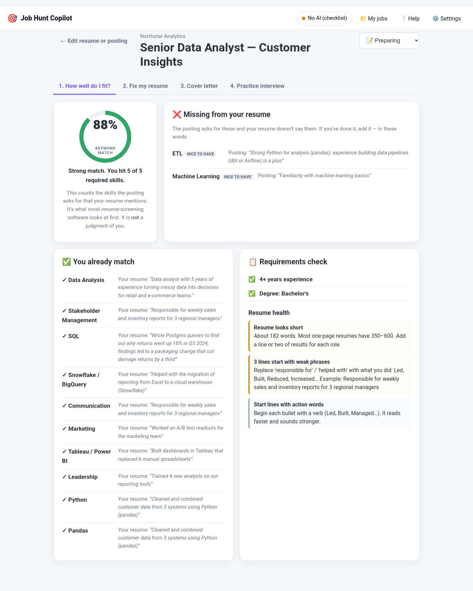

# 🎯 Job Hunt Copilot

**Paste your resume and a job posting. See exactly what's missing, get your resume and cover letter rewritten for that job, and practice the interview — all on your own computer.**



What you get for each job:

- **How well do I fit?** — a keyword match score, the skills the posting asks for that your resume doesn't mention, the ones you already match (with the line that proves it), and quick fixes for your resume's format
- **Fix my resume** — the AI rewords your resume for this job **using only what's already in it**, and shows every change in color so you can check it
- **Cover letter** — short and specific, from your real experience
- **Practice interview** — likely questions for this exact job, with feedback on your answers
- **My jobs** — every job you've compared, with a status (preparing / applied / interviewing / offer)

> **Private by design.** With "On my computer" or "No AI", nothing leaves your PC. The gap analysis, format checks, and interview questions never need AI at all.

---

## Install (3 steps, about 3 minutes)

Works on Ubuntu, Debian, and most Linux. You need Python 3.10 or newer (most Linux already has it).

**1. Get the code**

```bash
git clone https://github.com/Sockshare/job-hunt-copilot.git
cd job-hunt-copilot
```

**2. Set up Python (one time)**

```bash
python3 -m venv .venv
source .venv/bin/activate
pip install -r requirements.txt
```

> If `python3 -m venv` complains about *ensurepip*, run `sudo apt install python3-venv` and try again.
> No admin rights? Use this instead of the first line: `python3 -m venv --without-pip .venv && . .venv/bin/activate && curl -sS https://bootstrap.pypa.io/get-pip.py | python`

**3. Start it**

```bash
python app.py
```

Your browser opens to `http://127.0.0.1:8767`. Click **Use an example resume + job** to see it work.

Next time, just run `source .venv/bin/activate` and `python app.py`.

---

## First time: pick how the AI runs

| Option | What you get | Cost | Private? |
|---|---|---|---|
| **💻 On my computer** (Ollama) | Everything. Rewrites take 1–4 minutes. | Free | ✅ Yes |
| **☁️ Cloud AI key** (OpenAI / Gemini) | Everything, best writing, fast. | Pennies per job | ❌ Resume + posting sent to that company |
| **🔒 No AI** | Gap analysis, format checks, interview questions, fill-in templates. No rewriting. | Free | ✅ Yes |

Free private option: install [Ollama](https://ollama.com) with `curl -fsSL https://ollama.com/install.sh | sh`, then `ollama pull llama3.2:3b`. For better writing on a computer with 8 GB RAM, `ollama pull qwen2.5:7b` and pick it in Settings.

---

## How to use it

1. **Add your resume** — drop the PDF/Word file in, or paste the text. The app can remember it so you only do this once.
2. **Paste the job posting** — the whole thing: description and requirements.
3. **Compare them.** Takes a second.
4. Work through the four tabs: **fit → resume → cover letter → interview**.

The resume rewrite shows red lines (removed) and green lines (added). **Read every green line.** If the AI added anything that isn't true about you, delete it. The app also warns you if new numbers, years, or names appear that weren't in your original.

Full tour with pictures: [docs/USER_GUIDE.md](docs/USER_GUIDE.md)

---

## Something not working?

```bash
python scripts/selfcheck.py
```

Then see [docs/TROUBLESHOOTING.md](docs/TROUBLESHOOTING.md).

## More

- [User Guide](docs/USER_GUIDE.md) · [FAQ](docs/FAQ.md) · [Privacy](docs/PRIVACY.md) · [Troubleshooting](docs/TROUBLESHOOTING.md) · [Architecture](docs/ARCHITECTURE.md) · [Quality report](QUALITY.md)

## Important

The keyword score measures word overlap, like resume-screening software does. It is not a judgment of you or your chances. Never let the app put anything on your resume that isn't true — you are responsible for what you send.

## License

MIT — free to use, share, and change. See [LICENSE](LICENSE).
