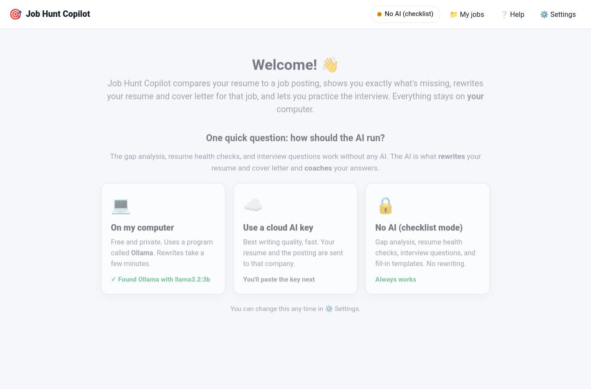
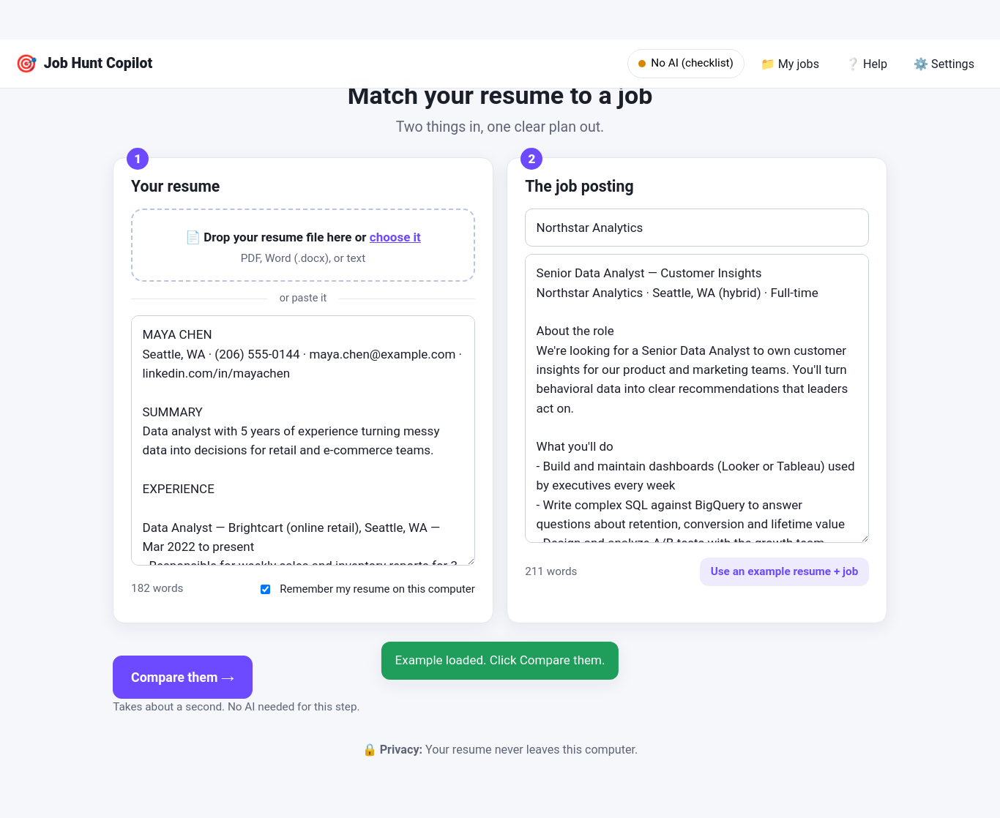
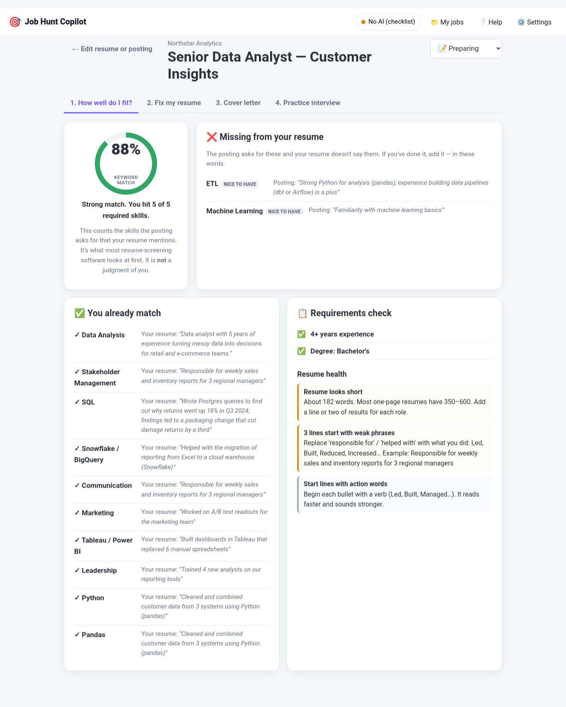
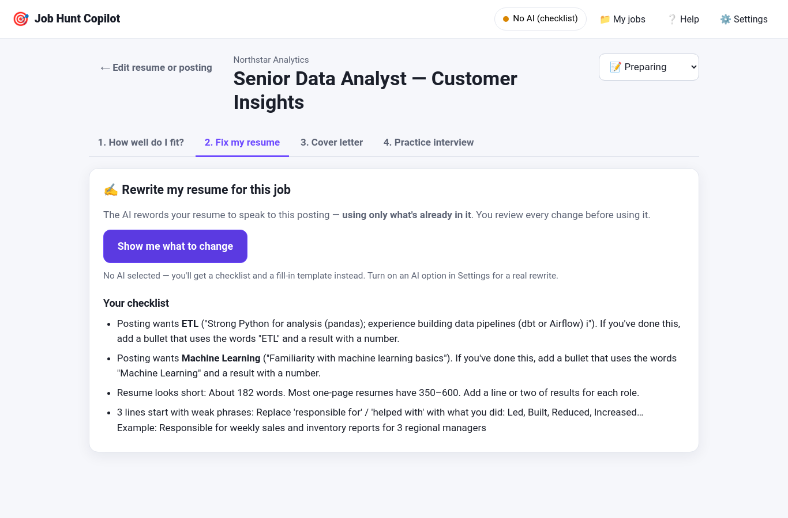
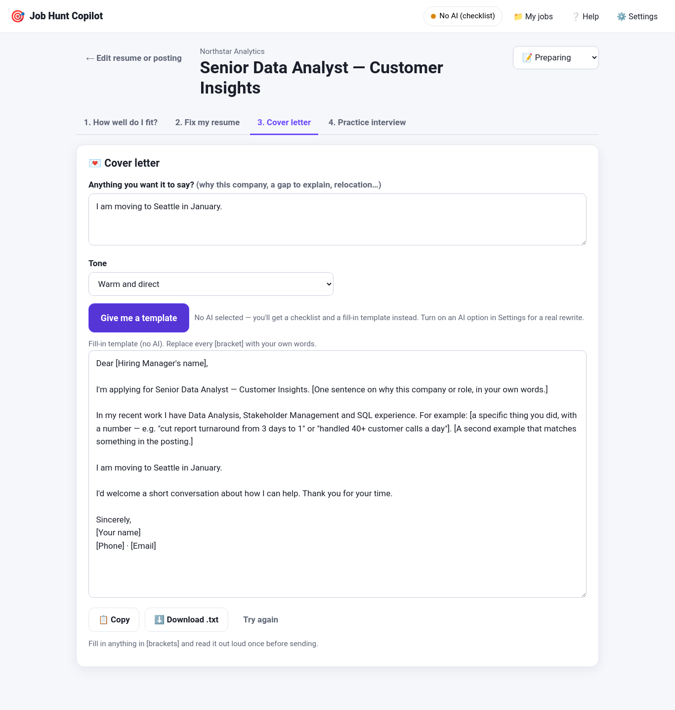
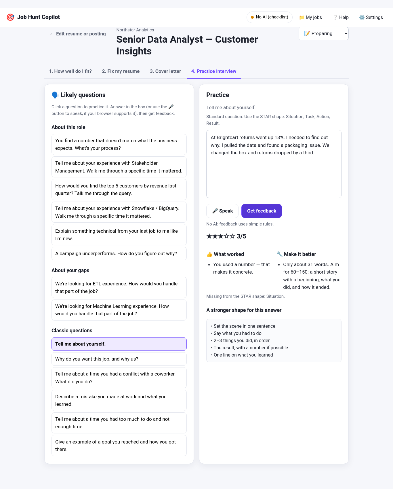
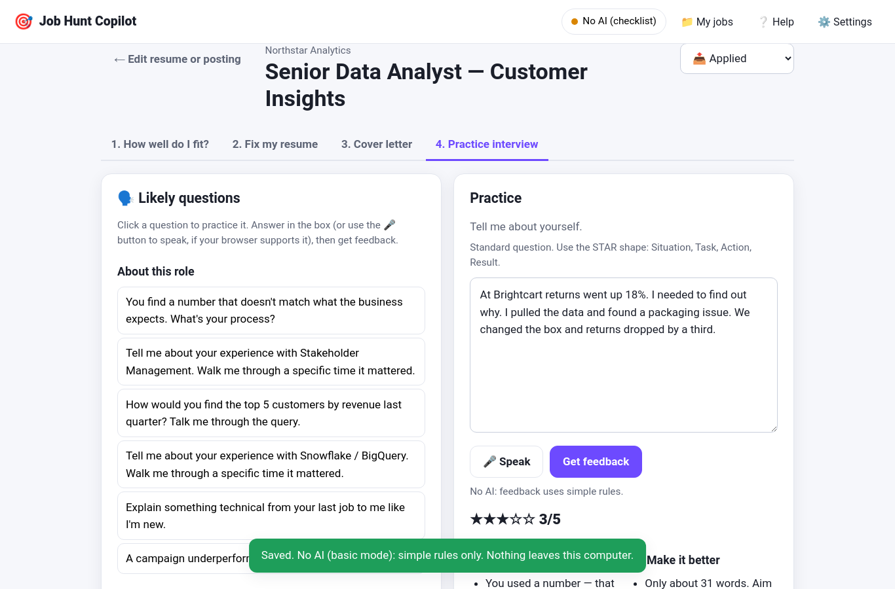

# User Guide

## Quick tour

1. Start the app: `python app.py`
2. Pick how the AI runs (first time only).
3. Add your resume and paste a job posting. Click **Compare them**.
4. Work through the four tabs: fit → resume → cover letter → interview.

---

## Screen 1: Welcome (first time only)

- **💻 On my computer** — Ollama, free and private. Rewrites take a few minutes.
- **☁️ Cloud AI key** — OpenAI or Gemini. Best writing. Your resume and the posting are sent to them.
- **🔒 No AI (checklist mode)** — the gap analysis, format checks and interview questions, plus fill-in templates instead of AI writing.

Change it any time in ⚙️ Settings.

---

## Screen 2: Your resume and the job

**Step 1 — Your resume.** Drop a PDF or Word file onto the box, or paste the text. Check the box "Remember my resume" and it will be filled in next time.

**Step 2 — The job posting.** Paste the whole posting from the website, including the requirements. Add the company name if you like.

**Use an example resume + job** loads a sample so you can explore.

Click **Compare them**. This takes about a second and needs no AI.

---

## Tab 1: How well do I fit?

**The score ring** — the share of skills the posting names that your resume also mentions. Required skills count double. Green is 70%+, orange 45–69%, red below. This is what resume-screening software measures; it says nothing about how good you are.

**❌ Missing from your resume** — skills the posting asks for that your resume doesn't say. Each shows the line from the posting. Tagged **required** or **nice to have**. If you've actually done it, add it to your resume in these words.

**✅ You already match** — with the exact line from your resume that proves it.

**📋 Requirements check** — years of experience, degree, certifications the posting named, with ✅ / ❌ / ❓ and a tip.

**Resume health** — plain checks that trip up screening software and recruiters: missing contact info, missing standard headings, weak phrases ("responsible for"), too few numbers, length.

---

## Tab 2: Fix my resume

**With an AI option:** click **Rewrite it for me**. The AI rewords your resume to speak to this posting while keeping every employer, title, date and fact. When it's done you see:

- **Red lines** = removed. **Green lines** = added. Toggle **Show clean copy** to see the final text.
- A list of what changed and why.
- **"Couldn't address honestly"** — posting requirements your resume doesn't show. Nothing was invented for these.
- **⚠️ Warnings** if new numbers, years or names appeared that weren't in your original. Check them.

Copy or download the result. **Read every green line before you use it.**

**Without AI:** you get a checklist — each missing skill with the posting's wording, and each format fix.

---

## Tab 3: Cover letter

Optionally add anything you want it to say (why this company, a gap to explain, relocation). Pick a tone. Click **Write it**.

The letter is under 300 words, uses only facts from your resume and what you typed, and has [brackets] for things you must fill in (the hiring manager's name). Without AI you get a fill-in template with your top matching skills already placed.

---

## Tab 4: Practice interview

**Left:** likely questions in three groups — about this role (based on skills the posting asked for that you have), about your gaps (skills you're missing — have an honest answer ready), and classic questions. Each has a note on why they ask it.

**Right:** click a question, type your answer as you'd say it (or press 🎤 to speak in Chrome), then **Get feedback**. You get a 1–5 score, what worked, what to improve, whether you covered Situation/Task/Action/Result, and a stronger outline for the same answer. Without AI the feedback uses simple rules (length, numbers, "I" vs "we", STAR parts).

Practice the same question again — your answers are saved with the job.

---

## The status dropdown and My jobs

Top right of the results: set **Preparing / Applied / Interviewing / Offer / Not this time / Archived**. **📁 My jobs** lists everything you've compared with its score and status; open one to pick up where you left off.

---

## Settings

- **Which AI** — the same three choices. Click **Test** after pasting a key.
- **Privacy** — "Save the jobs I compare" (on by default; everything is in `~/.job_hunt_copilot/`). **My jobs → Delete all** removes everything including your saved resume.
